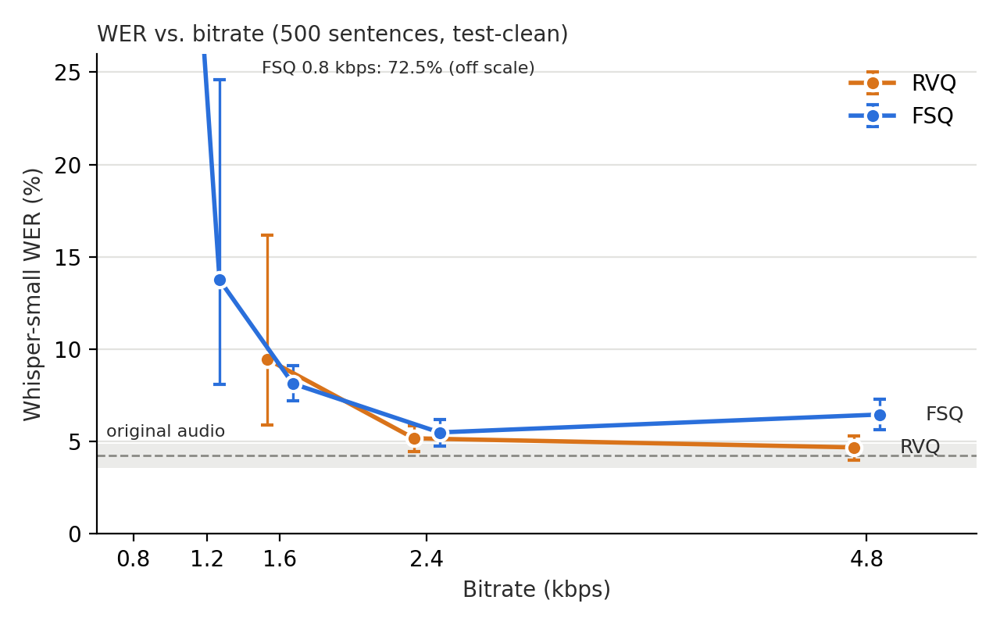

# Low-bitrate factorized speech codec: FSQ distillation and an environment factor on FACodec

Small research project on top of [FACodec](https://huggingface.co/amphion/naturalspeech3_facodec) (NaturalSpeech 3).


Two questions:

1. Can the RVQ quantizers of FACodec be replaced by finite scalar quantization (FSQ), by distillation from the frozen codec?
   Evaluated with Whisper WER, log-mel distance and speaker similarity versus bitrate.
2. Can an explicit *environment* factor (room reverberation, noise), learned from synthetic degradations, be swapped between utterances?

## Findings

- **FSQ distillation works down to about 1.2 kbps.** At 2.4 kbps the WER is on par with RVQ; at 1.6 kbps the two are comparable;
  at 0.8 kbps it collapses.
- **Equal WER is not equal fidelity:** at 2.4 kbps the FSQ is slightly worse on log-mel distance and speaker similarity.
- **The distilled FSQ residual (4.8 kbps) hurts** instead of helping; the cause is unknown.
- **Environment factor: partial result.** The encoder recovers the RT60 of unseen rooms (r = 0.87) and the renderer responds to it monotonically,
  but rendering costs intelligibility and tends to over-reverberate. The criterion "swapping the factor changes acoustics without degrading WER" is not met.



All numbers, with 95% bootstrap confidence intervals and controls, are in [RESULTS.md](RESULTS.md).

## Limitations

One training run per configuration; one ASR (Whisper-small); one dataset (LibriSpeech test-clean); synthetic simulated rooms only;
no RVQ reference below 1.6 kbps. Explanations for the FSQ residual failure and the renderer's over-reverberation are untested hypotheses.
No random seed is fixed in `train_fsq.py` and `train_env.py`; re-running training gives slightly different numbers. The reported results come from a single run per configuration.

## Reproducing

```bash
git clone https://github.com/open-mmlab/Amphion
git -C Amphion checkout $(cat AMPHION_COMMIT.txt)
pip install -r requirements.txt            # also install Amphion's own requirements
export AMPHION_PATH=$PWD/Amphion

python train_fsq.py --name A --p-bits 10 --c-bits 20 --r-bits 30   # 4.8 kbps (2.4 without residual)
python train_fsq.py --name B --p-bits 10 --c-bits 10               # 1.6 kbps
python train_fsq.py --name C --p-bits 5  --c-bits 10               # 1.2 kbps
python train_fsq.py --name D --p-bits 5  --c-bits 5                # 0.8 kbps
python test_wer.py && python eval_curve.py && python plot_curve.py && python eval_extra.py

python make_bank.py && python train_env.py --steps 6000
python eval_env.py && python diag_rt60.py && python diag_deltart60.py
```

LibriSpeech is downloaded to `./data` by the scripts. `setuptools<81` is required by `pyworld`.
Config A was trained with an earlier version of `train_fsq.py` (same configuration).

## License and attribution

Code: MIT (see `LICENSE`). Builds on [Amphion](https://github.com/open-mmlab/Amphion) (MIT) and the FACodec checkpoints
[`amphion/naturalspeech3_facodec`](https://huggingface.co/amphion/naturalspeech3_facodec) (Apache-2.0 per the model card),
downloaded at run time.

## References

- Z. Ju et al., *NaturalSpeech 3: Zero-Shot Speech Synthesis with Factorized Codec and Diffusion Models*, arXiv:2403.03100.
- X. Zhang et al., *Amphion: An Open-Source Audio, Music and Speech Generation Toolkit*, arXiv:2312.09911.
- F. Mentzer et al., *Finite Scalar Quantization: VQ-VAE Made Simple*, arXiv:2309.15505.
- A. Radford et al., *Robust Speech Recognition via Large-Scale Weak Supervision* (Whisper), arXiv:2212.04356.
- S. Chen et al., *WavLM*, arXiv:2110.13900.
